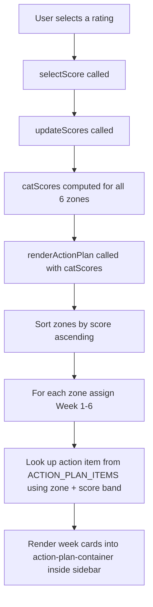

# Targeted Action Plan — Implementation Plan

## Overview

Add a **Targeted Action Plan** section to [`webapp.html`](../webapp.html) as a **third card inside the `.sticky-side` sidebar**, directly after the existing metrics card. Each week corresponds to one CIRCLe zone, ordered from lowest-scoring (Week 1 = most urgent) to highest-scoring (Week 6 = strongest). The action item shown for each zone is selected from a hardcoded lookup table based on the zone's current score band.

The section updates **live** whenever the user changes any rating, exactly like the radar wheel and metric tiles. Because the sidebar already has `overflow-y: auto`, the week cards scroll naturally within it.

---

## Architecture



---

## Score Band Logic

| Score Range | Band Key | Label |
|---|---|---|
| 1.0 – 2.9 | `1` | Crisis |
| 3.0 – 4.9 | `2` | Developing |
| 5.0 – 6.4 | `3` | Established |
| 6.5 – 7.9 | `4` | Advanced |
| 8.0 – 10.0 | `5` | Exemplary |

```js
function getScoreBand(score) {
    if (score < 3.0) return 1;
    if (score < 5.0) return 2;
    if (score < 6.5) return 3;
    if (score < 8.0) return 4;
    return 5;
}
```

---

## Hardcoded Action Items

Structure: `ACTION_PLAN_ITEMS[zoneName][band]` → `{ title, action }`

### Zone: Capacity

| Band | Title | Action |
|---|---|---|
| 1 | Supervision & Delegation Audit | Your Capacity scores indicate a critical gap in how supervision and delegation flow through your reporting lines. This week, map every direct report and identify whether each person has a clear, regular supervision touchpoint. Block time in your calendar for structured 1:1s and commit to holding them without cancellation for the next six weeks. |
| 2 | Establish Supervision Rhythms | Supervision and delegation are inconsistent across your team. Introduce a simple weekly check-in template for your direct reports to complete before each 1:1. Use it to surface blockers, workload concerns, and delegation gaps. Share the template upward too — ask your own manager to adopt it with you. |
| 3 | Calibrate Delegation Depth | Your Capacity zone is functional but there is room to sharpen how work is delegated. Review the last month of tasks you handled personally and identify three that could have been delegated. For each, document why you retained it and what would need to be true for you to delegate it next time. |
| 4 | Stretch Delegation Upward and Downward | You have solid supervision and delegation practices. Now focus on stretching them. Identify one report who is ready for a step-up assignment and one area where you could push back upward for greater autonomy. Document both as explicit development conversations this week. |
| 5 | Model and Codify Best Practice | Your Capacity zone is exemplary. Use this strength to benefit others. Write a one-page guide to your supervision and delegation approach and share it with peers or use it as a coaching tool with your reports. Offer to mentor a peer leader who is struggling in this area. |

### Zone: Innovation

| Band | Title | Action |
|---|---|---|
| 1 | Create Psychological Safety First | Innovation cannot happen where people fear blame. This week, hold a team conversation explicitly naming that experimentation is encouraged and that failed attempts will be treated as learning. Follow up by publicly acknowledging one recent attempt at change — however small — and thanking the person who made it. |
| 2 | Open an Innovation Channel | Your team lacks a reliable mechanism for surfacing new ideas. Introduce a lightweight process this week: a shared document, a standing agenda item, or a brief monthly session where anyone can propose an improvement without needing to justify it upfront. Make participation voluntary but visibly valued. |
| 3 | Run a Structured Experiment | You have a reasonable innovation culture but it tends to be passive. Identify one process or tool your team uses that has not been reviewed in over a year. Assign a small group to spend two hours proposing an improvement. Present findings at the next team meeting and commit to acting on at least one suggestion. |
| 4 | Connect Innovation to Strategy | Your innovation culture is strong. Now link it explicitly to organisational goals. This week, facilitate a session where your team maps their recent ideas to the company's strategic priorities. Help them see which innovations have the highest leverage and coach them on how to build a business case for the most promising one. |
| 5 | Become an Innovation Sponsor | You lead an exemplary innovation culture. Extend your influence by sponsoring innovation beyond your immediate team. Volunteer to chair or contribute to a cross-functional innovation forum, or propose a structured hackathon or ideas challenge. Document your team's innovation wins and share them with senior leadership. |

### Zone: Resolve

| Band | Title | Action |
|---|---|---|
| 1 | Rebuild Commitment Foundations | Low Resolve scores suggest disengagement — in yourself or your team — from the organisation or role. This week, have honest one-to-one conversations with your key reports to understand their current level of commitment and what is driving any dissatisfaction. Do not try to fix everything immediately; listen first and acknowledge what you hear. |
| 2 | Address Profile and Training Gaps | Resolve is developing but profiles, training access, and market value awareness are inconsistent. This week, review your own professional profile and update it. Then ask each direct report when they last updated theirs. Identify one training opportunity per person and raise it formally with HR or your manager as a development investment. |
| 3 | Strengthen Industry Presence | Your Resolve zone is solid but industry engagement could be deeper. Identify one external event, webinar, or professional community relevant to your field and commit to attending or participating in the next six weeks. Encourage at least two of your reports to do the same and offer to cover any reasonable cost or time. |
| 4 | Actively Manage Market Value | You and your team are well-committed and professionally engaged. Now be intentional about market value. This week, research current salary benchmarks and role expectations for your level and your reports' levels. Use this data in your next performance or development conversation to ensure everyone understands their market position and trajectory. |
| 5 | Champion Resolve Across the Organisation | Your Resolve zone is exemplary. Use your position to advocate for professional development investment at an organisational level. Propose a structured programme — mentoring circles, conference budgets, or profile-building workshops — and present it to your leadership team with a clear case for return on investment. |

### Zone: Career Clarity

| Band | Title | Action |
|---|---|---|
| 1 | Define Your Three-Year Direction | Career Clarity is critically low. Without a direction, daily decisions lack coherence. This week, set aside two hours to write down — in plain language — where you want to be professionally in three years. It does not need to be perfect. Share it with one trusted colleague or coach and ask for honest feedback on whether your current role is aligned with that direction. |
| 2 | Map the Gap | You have some career direction but the path is unclear. Create a simple two-column document: on the left, your three-year goal; on the right, your current role's actual activities. Identify the three biggest gaps. For each gap, name one concrete action you could take in the next six weeks to begin closing it. |
| 3 | Pull the Right Levers | Your career direction is reasonably clear but you may not be actively using all available levers. This week, identify three specific opportunities within your organisation — projects, committees, relationships, or visibility moments — that directly support your career path. Commit to pursuing at least one of them before the end of the six-week plan. |
| 4 | Align Your Team's Clarity with Your Own | You have strong personal career clarity. Now extend that discipline to your reports. This week, ask each direct report to articulate their three-year career goal. For those who cannot, offer a structured conversation to help them develop one. Align their development plans to their stated goals, not just their current role requirements. |
| 5 | Institutionalise Career Clarity | Career Clarity is a strength for you and your team. Formalise it. Propose or implement a structured career conversation framework — perhaps quarterly career check-ins separate from performance reviews — and advocate for it as standard practice across your wider organisation. |

### Zone: Leverage

| Band | Title | Action |
|---|---|---|
| 1 | Clarify Decision Boundaries Urgently | Low Leverage scores indicate that decision-making responsibilities are unclear, leading to bottlenecks, duplication, or avoidance. This week, write down every significant decision you made in the last month and categorise each as: mine alone, mine with input, or committee. Share this list with your manager and ask them to validate or correct your assumptions. |
| 2 | Document Personal Decision Scope | Decision clarity is developing but inconsistent. Create a one-page decision authority document for your role: what you decide alone, what requires escalation, and what requires committee. Share it with your direct reports so they understand when to come to you and when to act independently. |
| 3 | Improve Committee Effectiveness | Your personal decision scope is reasonably clear but committee processes may be inefficient. Identify the committee or group decision-making forum you participate in most frequently. This week, assess whether it has a clear terms of reference, a defined quorum, and a record of decisions made. If not, propose improvements to the chair or facilitator. |
| 4 | Empower Reports to Decide | You have strong decision clarity. Now use it to empower your team. Review the decisions your reports currently escalate to you and identify which ones they should be making themselves. Have an explicit conversation with each report about expanding their decision authority and what support they need to exercise it confidently. |
| 5 | Design Decision Architecture | Your Leverage zone is exemplary. Apply your expertise at a systemic level. Review the decision-making architecture across your broader function or department. Identify where authority is misaligned with accountability and propose a clearer RACI or delegation framework. Present your findings to senior leadership as a governance improvement. |

### Zone: External Interfaces

| Band | Title | Action |
|---|---|---|
| 1 | Conduct an Obligations Audit | Critical gaps exist in your team's understanding of HR, Compliance, InfoSec, or Buildings Management obligations. This week, contact each of these functions and request a briefing or summary of the key obligations relevant to your team. Do not assume your team knows what they need to know — schedule a short team session to share what you learn. |
| 2 | Close the Most Critical Gap | You have partial awareness of external obligations but significant gaps remain. Identify which function — HR, Compliance, InfoSec, or Buildings Management — represents the highest risk if misunderstood. Focus this week on that one area: read the relevant policy, speak to the function lead, and brief your team on the top three things they must know. |
| 3 | Build Ongoing Interface Relationships | Your external interface awareness is functional. Now make it relational rather than transactional. This week, introduce yourself formally to the leads of HR, Compliance, InfoSec, and Buildings Management if you have not already. Ask each one: what do you most need tech leaders to understand or do differently? Use their answers to update your team briefings. |
| 4 | Embed Compliance into Team Culture | You have strong external interface awareness. Now make it self-sustaining. Introduce a brief standing agenda item in your team meetings for compliance and policy updates. Assign a rotating responsibility to a team member to monitor and report on changes from each external function. This distributes the knowledge and builds resilience. |
| 5 | Become a Cross-Functional Bridge | Your External Interfaces zone is exemplary. Use your position to improve how tech and support functions collaborate organisation-wide. Propose a regular cross-functional forum or liaison model where tech leaders and function heads share updates, flag risks, and align on obligations. Volunteer to chair or co-chair the first session. |

---

## UI Layout

The action plan renders as a **third `.card` inside `.sticky-side`**, directly after the closing `</div>` of the metrics card (currently line 123 of [`webapp.html`](../webapp.html)). The sidebar is already `overflow-y: auto` so the week cards scroll naturally within it alongside the radar and metrics.

Each week card is a compact vertical stack suited to the 360px sidebar column width — no horizontal two-column layout:

```
┌─────────────────────────────────────┐  ← .sticky-side (360px)
│  [Radar Wheel Card]                 │
│  [Metrics Card]                     │
│  ┌─────────────────────────────┐    │  ← new .card (action plan)
│  │ 🎯 Targeted Action Plan     │    │
│  │ Week 1–6 based on scores    │    │
│  │                             │    │
│  │ ┌─────────────────────────┐ │    │
│  │ │ WEEK 1  · Most Urgent   │ │    │
│  │ │ [Capacity] badge        │ │    │
│  │ │ Score: 3.2 · Developing │ │    │
│  │ │ Title text              │ │    │
│  │ │ Action paragraph...     │ │    │
│  │ └─────────────────────────┘ │    │
│  │ ┌─────────────────────────┐ │    │
│  │ │ WEEK 2                  │ │    │
│  │ │ [Innovation] badge      │ │    │
│  │ │ ...                     │ │    │
│  │ └─────────────────────────┘ │    │
│  │ ... (weeks 3–6)             │    │
│  └─────────────────────────────┘    │
└─────────────────────────────────────┘
```

### Zone colour coding (matches existing palette)

| Zone | Accent colour |
|---|---|
| Capacity | `#2563eb` (blue) |
| Innovation | `#7c3aed` (violet) |
| Resolve | `#0d9488` (teal) |
| Career Clarity | `#16a34a` (green) |
| Leverage | `#d97706` (amber) |
| External Interfaces | `#dc2626` (red) |

---

## JavaScript Logic

### New data structure to add to `<script>`

```js
const ZONE_COLOURS = {
    "Capacity":            "#2563eb",
    "Innovation":          "#7c3aed",
    "Resolve":             "#0d9488",
    "Career Clarity":      "#16a34a",
    "Leverage":            "#d97706",
    "External Interfaces": "#dc2626"
};

const ACTION_PLAN_ITEMS = {
    "Capacity": {
        1: { title: "Supervision & Delegation Audit", action: "..." },
        2: { title: "Establish Supervision Rhythms",  action: "..." },
        3: { title: "Calibrate Delegation Depth",     action: "..." },
        4: { title: "Stretch Delegation Upward and Downward", action: "..." },
        5: { title: "Model and Codify Best Practice", action: "..." }
    },
    // ... repeat for all 6 zones
};

function getScoreBand(score) {
    if (score < 3.0) return 1;
    if (score < 5.0) return 2;
    if (score < 6.5) return 3;
    if (score < 8.0) return 4;
    return 5;
}

const BAND_LABELS = { 1: "Crisis", 2: "Developing", 3: "Established", 4: "Advanced", 5: "Exemplary" };
```

### `renderActionPlan(catScores)` function

```js
function renderActionPlan(catScores) {
    // 1. Build array of { zone, score } and sort ascending by score
    const sorted = CATEGORIES
        .map(cat => ({ zone: cat, score: catScores[cat] }))
        .sort((a, b) => a.score - b.score);

    // 2. Render each week
    const container = document.getElementById('action-plan-container');
    container.innerHTML = sorted.map((item, idx) => {
        const week = idx + 1;
        const band = getScoreBand(item.score);
        const { title, action } = ACTION_PLAN_ITEMS[item.zone][band];
        const colour = ZONE_COLOURS[item.zone];
        const bandLabel = BAND_LABELS[band];
        const isFirst = week === 1;

        return `
            <div class="ap-week-card ${isFirst ? 'ap-week-card--urgent' : ''}">
                <div class="ap-week-header">
                    <span class="ap-week-num">Week ${week}</span>
                    ${isFirst ? '<span class="ap-urgent-tag">Most Urgent</span>' : ''}
                    <span class="ap-zone-badge" style="background:${colour}18;color:${colour};border-color:${colour}35">${item.zone}</span>
                </div>
                <div class="ap-score-band">Score: ${item.score.toFixed(1)} &nbsp;·&nbsp; ${bandLabel}</div>
                <div class="ap-action-title">${title}</div>
                <div class="ap-action-text">${action}</div>
            </div>
        `;
    }).join('');
}
```

### Hook into `updateScores()`

At the end of the existing [`updateScores()`](../webapp.html:303) function, after `drawSvgRadar(catScores)`, add:

```js
renderActionPlan(catScores);
```

---

## CSS Additions

Add to the existing `<style>` block. Note: the week cards use a **single-column compact layout** (no flex row) to fit the 360px sidebar:

```css
/* ── Targeted Action Plan ─────────────────────────────── */
.ap-section-label {
    font-size: 11px;
    font-weight: 800;
    color: #94a3b8;
    text-transform: uppercase;
    margin-bottom: 2px;
}
.ap-section-desc {
    font-size: 11px;
    color: #94a3b8;
    margin-bottom: 14px;
}
.ap-week-card {
    background: #f8fafc;
    border: 1px solid #e2e8f0;
    border-radius: 10px;
    padding: 12px 14px;
    margin-bottom: 10px;
}
.ap-week-card--urgent {
    border-color: #fca5a5;
    background: #fff8f8;
}
.ap-week-header {
    display: flex;
    align-items: center;
    flex-wrap: wrap;
    gap: 6px;
    margin-bottom: 4px;
}
.ap-week-num {
    font-size: 11px;
    font-weight: 800;
    color: #94a3b8;
    text-transform: uppercase;
    letter-spacing: 0.05em;
    white-space: nowrap;
}
.ap-urgent-tag {
    font-size: 10px;
    font-weight: 700;
    color: #dc2626;
    background: #fee2e2;
    border-radius: 10px;
    padding: 1px 7px;
    white-space: nowrap;
}
.ap-zone-badge {
    font-size: 10px;
    font-weight: 800;
    text-transform: uppercase;
    letter-spacing: 0.05em;
    padding: 2px 8px;
    border-radius: 20px;
    border: 1px solid;
    white-space: nowrap;
}
.ap-score-band {
    font-size: 10px;
    color: #94a3b8;
    font-weight: 600;
    margin-bottom: 6px;
}
.ap-action-title {
    font-size: 13px;
    font-weight: 800;
    color: #0f172a;
    margin-bottom: 4px;
}
.ap-action-text {
    font-size: 12px;
    color: #475569;
    line-height: 1.6;
}
```

---

## HTML Addition

Add a **third card** inside `.sticky-side`, immediately after the closing `</div>` of the metrics card (after line 123 of [`webapp.html`](../webapp.html)):

```html
<!-- Targeted Action Plan -->
<div class="card">
    <div class="ap-section-label">🎯 Targeted Action Plan</div>
    <div class="ap-section-desc">Your personalised 6-week plan, Week 1 = most urgent zone.</div>
    <div id="action-plan-container"></div>
</div>
```

---

## Files to Modify

| File | Change |
|---|---|
| [`webapp.html`](../webapp.html) | Add CSS, HTML card inside sidebar, JS data + functions |

No new files are required — everything is self-contained in the single HTML file.

---

## Implementation Checklist for Code Mode

- [ ] Add `ZONE_COLOURS` constant to `<script>`
- [ ] Add `ACTION_PLAN_ITEMS` constant with all 30 action items (6 zones × 5 bands) to `<script>`
- [ ] Add `getScoreBand(score)` helper function to `<script>`
- [ ] Add `BAND_LABELS` constant to `<script>`
- [ ] Add `renderActionPlan(catScores)` function to `<script>`
- [ ] Call `renderActionPlan(catScores)` at the end of `updateScores()`
- [ ] Add action plan CSS to `<style>` block
- [ ] Add action plan HTML card inside `.sticky-side`, after the metrics card
- [ ] Verify live update works when ratings change
- [ ] Verify Week 1 always shows lowest-scoring zone with "Most Urgent" tag
- [ ] Verify compact layout fits correctly within the 360px sidebar column
